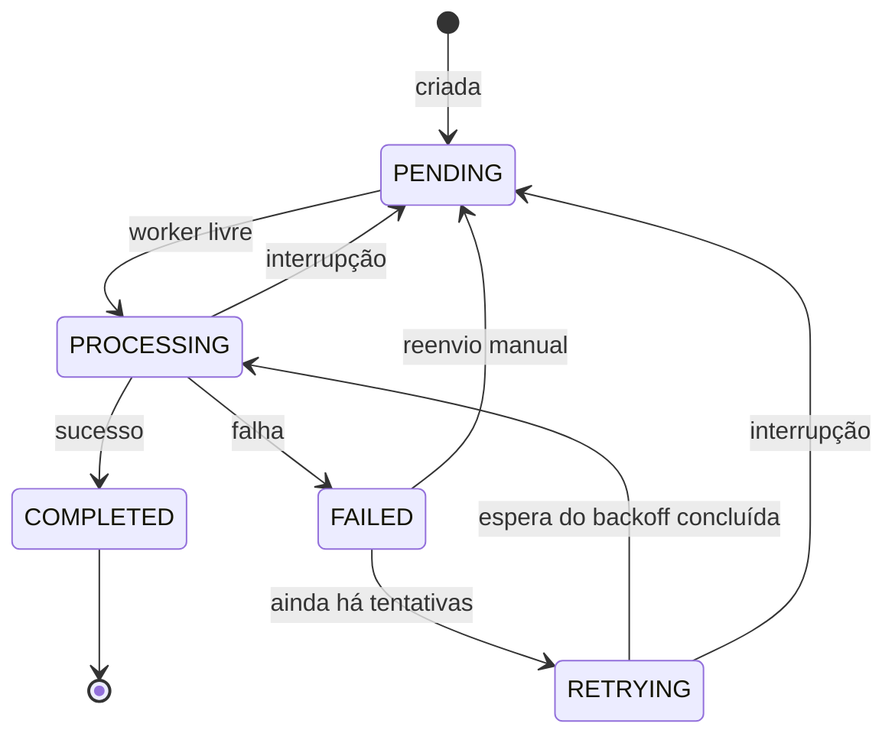

# FlowBoard

**Simulador visual e interativo de processamento assíncrono de tarefas, construído com Angular 22, Signals e RxJS.**

O FlowBoard representa uma fila de processamento: você cria tarefas (ou gera um cenário de demonstração), inicia a simulação e acompanha, em tempo real, as tarefas passando por `PENDING → PROCESSING → COMPLETED`, falhando, fazendo retry com backoff exponencial e alimentando métricas e gráficos.

> **Importante:** o FlowBoard é uma **simulação educacional executada inteiramente no navegador**. Ele não é um sistema de mensageria real: não há backend, fila distribuída, workers em outras threads nem garantias de entrega. Os "workers" são temporizadores RxJS, e o estado vive em Signals e no `localStorage`.

<!-- Adicione aqui um GIF ou screenshot:  -->

---

## Sumário

- [Objetivo técnico](#objetivo-técnico)
- [Tecnologias](#tecnologias)
- [Funcionalidades](#funcionalidades)
- [Instalação e execução](#instalação-e-execução)
- [Arquitetura](#arquitetura)
- [Gerenciamento de estado com Signals](#gerenciamento-de-estado-com-signals)
- [O motor assíncrono](#o-motor-assíncrono)
- [Persistência](#persistência)
- [Testes](#testes)
- [Publicação no GitHub Pages](#publicação-no-github-pages)
- [Limitações da simulação](#limitações-da-simulação)

---

## Objetivo técnico

Demonstrar, em um projeto pequeno e fácil de executar, práticas modernas de frontend com Angular:

- **Reatividade com Signals** (`signal`, `computed`, `effect`, `linkedSignal`) como fonte única de estado, **sem NgRx**.
- **RxJS onde ele brilha**: temporizadores e cancelamento do motor de processamento.
- **Máquina de estados explícita**, que impede transições inválidas tanto do motor quanto do usuário (drag & drop).
- **Concorrência controlada**, prioridade com FIFO, falhas probabilísticas e retry com backoff.
- **Testabilidade**: relógio e gerador aleatório injetáveis, timers falsos e nenhum atraso real nos testes.
- **Arquitetura por feature**, componentes standalone, `OnPush`, zoneless e lazy loading.

## Tecnologias

| Área | Escolha |
|---|---|
| Framework | Angular 22 (standalone, zoneless, `OnPush`, novo control flow `@if`/`@for`/`@switch`/`@defer`) |
| Linguagem | TypeScript 6 em modo `strict` + `strictTemplates` |
| Estado | Angular Signals (`signal`, `computed`, `effect`, `linkedSignal`, `afterRenderEffect`) |
| Assíncrono | RxJS 7 (`timer`, `interval`, `takeUntilDestroyed`) |
| Formulários | Reactive Forms tipados + `ControlValueAccessor` próprios |
| Drag & drop | Angular CDK |
| Gráficos | Chart.js 4 (apenas os módulos usados, carregados sob demanda) |
| Estilos | SCSS com design tokens em CSS custom properties (tema claro/escuro) |
| Testes | Vitest (builder oficial `@angular/build:unit-test`) + jsdom |
| Qualidade | ESLint (angular-eslint) + Prettier |

Nenhuma biblioteca de componentes foi usada: dialog, toasts, sliders, controles segmentados e ícones são componentes próprios e acessíveis. O modal usa o elemento nativo `<dialog>`.

## Funcionalidades

- **Dashboard**: oito indicadores calculados com `computed()` (total, pendentes, em processamento, concluídas, com erro, taxa de sucesso, tempo médio, throughput por minuto), cinco gráficos e um painel de atividade recente.
- **Quadro Kanban**: colunas *Pendentes*, *Processando*, *Concluídas* e *Falhas*, com barra de progresso de cada tentativa e da espera de retry. A coluna *Pendentes* mostra a ordem real em que as tarefas serão processadas.
- **Drag & drop validado**: só movimentos permitidos pela máquina de estados podem ser feitos. Uma tarefa com falha arrastada para *Pendentes* é reenviada; uma em processamento é interrompida. As colunas que aceitam o card se destacam durante o arraste, e todas as ações também existem como botões acessíveis por teclado.
- **Cadastro de tarefas**: formulário reativo com título, descrição, prioridade, duração simulada e probabilidade de falha, com validações e mensagens.
- **Motor de processamento**: concorrência configurável, prioridade + FIFO, falhas probabilísticas, retry automático (intervalo fixo ou exponential backoff com limite), além de iniciar, pausar, retomar e interromper.
- **Gráficos**: tarefas por estado, concluídas ao longo do tempo, sucessos × falhas, tempo médio de processamento e throughput por minuto. Cada gráfico tem uma tabela equivalente.
- **Histórico**: linha do tempo de todas as transições (data/hora, tarefa, estado anterior e novo, descrição e tentativa), com filtros por tarefa, tipo e período. O link do card abre o histórico já filtrado.
- **Configurações**: concorrência, retries, estratégia, intervalo inicial, limite de backoff (com prévia da sequência de esperas), velocidade da simulação (0,5× a 4×), tema e limpeza de dados.
- **Modo demonstração**: gera 12 tarefas variadas. Com uma **seed fixa**, as tarefas *e* os sorteios de falha se repetem, útil para gravar vídeos.
- **Persistência**: tarefas, histórico, configurações e tema são salvos no `localStorage` e restaurados ao recarregar a página.
- **UX**: tema escuro por padrão e tema claro, layout responsivo (desktop, tablet e celular), skeletons, estados vazios, toasts, confirmação antes de apagar dados, navegação por teclado, link "pular para o conteúdo" e respeito a `prefers-reduced-motion`.

## Instalação e execução

Pré-requisitos: **Node.js 22+** (usado só como ferramenta de desenvolvimento e build) e npm.

```bash
git clone https://github.com/<seu-usuario>/flowboard.git
cd flowboard
npm install
npm start          # http://localhost:4200
```

| Comando | O que faz |
|---|---|
| `npm start` | Servidor de desenvolvimento com recarga automática |
| `npm run build` | Build de produção em `dist/flowboard/browser` |
| `npm run build:gh-pages` | Build com `base-href /flowboard/` + `404.html` para o GitHub Pages |
| `npm test` | Testes em modo watch |
| `npm run test:ci` | Testes uma única vez (CI) |
| `npm run lint` | ESLint em TypeScript e templates |
| `npm run format` / `format:check` | Prettier (corrige / verifica) |

**Roteiro rápido de demonstração:** abra o **Quadro**, clique em **Gerar cenário de demonstração** e depois em **Iniciar** no cabeçalho. Para repetir exatamente a mesma execução, use a seed em **Configurações → Modo demonstração**.

## Arquitetura

O código é organizado **por feature**. `core` contém singletons da aplicação, `shared` contém peças de UI genéricas, e cada feature reúne seus modelos, estado, serviços e componentes.

```text
src/app/
├── core/
│   ├── layout/            # shell: sidebar, header, navegação
│   ├── models/            # tipos transversais (tema)
│   ├── services/          # tema, toasts, confirmação, título de página, "agora"
│   ├── storage/           # persistência versionada no localStorage
│   └── utils/             # Clock e RandomSource injetáveis, igualdade estrutural
├── shared/
│   ├── components/        # dialog, chart, form-field, range-input, segmented-control, toast, icon…
│   ├── forms/             # validadores e mensagens de validação
│   └── pipes/             # duração
├── features/
│   ├── tasks/             # domínio: modelos, máquina de estados, TaskStore, EventLogStore, formulário, card
│   ├── simulation/        # motor de processamento, política de retry, métricas, configurações, demo
│   ├── dashboard/         # indicadores e gráficos           (rota lazy /dashboard)
│   ├── board/             # Kanban e drag & drop             (rota lazy /board)
│   ├── history/           # histórico com filtros            (rota lazy /history)
│   └── settings/          # configurações                    (rota lazy /settings)
├── app.config.ts          # providers: router, locale pt-BR, inicialização da persistência
├── app.routes.ts          # lazy loading por feature
└── app.ts                 # shell da aplicação
src/testing/               # FakeClock, SequenceRandom e MemoryStorage para testes
```

Decisões importantes:

- **Sem SSR**: o scaffold do Angular veio com SSR/Express, que foi removido. A aplicação é 100% estática, como exige a publicação no GitHub Pages e a restrição de não ter servidor.
- **Carregamento sob demanda**: cada página é uma rota lazy. O modal de criação vem por `@defer (on idle)` e os gráficos por `@defer (on viewport)`, então o Chart.js (cerca de 59 kB comprimido) só é baixado quando o usuário rola até os gráficos. O carregamento inicial fica em cerca de 92 kB comprimidos.
- **Componentes só leem estado**: eles consomem Signals somente-leitura e chamam métodos explícitos dos stores e serviços. A lógica de negócio fica em funções puras (seleção da próxima tarefa, retry, métricas, filtros, séries dos gráficos, regras do Kanban), fáceis de testar.

## Gerenciamento de estado com Signals

O estado é mantido em stores simples (`@Injectable` com `signal` privado e exposição `asReadonly()`). Todo valor derivado é um `computed()`, então nada é duplicado:

```typescript
@Injectable({ providedIn: 'root' })
export class TaskStore {
  private readonly _tasks = signal<readonly Task[]>([]);
  readonly tasks = this._tasks.asReadonly();

  readonly tasksByStatus = computed(() => groupByStatus(this._tasks()));
  readonly pending = computed(() => this.tasksByStatus().PENDING);

  transition(id: string, to: TaskStatus, options?: TransitionOptions): TransitionResult {
    // valida contra a máquina de estados, atualiza de forma imutável e registra o evento
  }
}
```

- **Imutabilidade**: toda alteração cria novos arrays e objetos (`update(tasks => tasks.map(...))`).
- **Métodos explícitos**: `create`, `update`, `transition`, `remove`, `restore` e `clear`. Uma transição inválida retorna `{ ok: false, error }` em vez de lançar exceção, o que o Kanban usa para recusar movimentos.
- **Rastreabilidade**: cada mudança registra um `TaskEvent` no `EventLogStore`, que alimenta o histórico, os gráficos e o throughput.
- **`computed()` com igualdade estrutural**: as séries dos gráficos são recalculadas a cada segundo, mas só propagam mudança quando os números mudam de fato.
- **`effect()` para efeitos colaterais**: aplicar o tema no `<html>`, salvar no `localStorage` e alimentar o motor quando a fila muda.
- **`linkedSignal()`**: filtro do histórico iniciado pelo query param `?task=` e paginação que volta ao início quando os filtros mudam.

### Máquina de estados



A tabela de transições ([task-state-machine.ts](src/app/features/tasks/models/task-state-machine.ts)) é a única fonte de verdade: ela define as transições válidas e o evento registrado em cada uma. Uma tarefa que esgota as tentativas permanece em `FAILED` até uma intervenção manual.

## O motor assíncrono

O [`ProcessingEngineService`](src/app/features/simulation/engine/processing-engine.service.ts) simula um pool de workers:

1. **Seleção**: sempre que há worker livre, escolhe a próxima tarefa por **prioridade** (alta → média → baixa) e, dentro da mesma prioridade, por **ordem de criação (FIFO)**. Tarefas cujo retry já pode rodar têm preferência sobre as pendentes.
2. **Concorrência**: no máximo `maxConcurrency` tarefas em `PROCESSING`. Uma tarefa aguardando retry **não** ocupa worker.
3. **Execução**: cada tentativa é um `timer()` do RxJS com a duração simulada dividida pela velocidade. Ao fim, um número de `RandomSource` é comparado com a probabilidade de falha da tarefa.
4. **Retry**: em caso de falha, se ainda houver tentativas, a tarefa vai para `RETRYING` e aguarda outro `timer()`:
   - fixo: `initialDelay` em todas as tentativas;
   - exponencial: `initialDelay × 2^(n-1)`, limitado por `maxRetryDelay` (por exemplo 1 s → 2 s → 4 s → 8 s).
5. **Pausa e retomada**: o tempo restante de cada tarefa é guardado em **milissegundos simulados**. Pausar cancela as inscrições e congela esse tempo; retomar cria novos timers só com o que faltava. Mudar a velocidade durante a execução reagenda os timers ativos.
6. **Interrupção**: cancela todos os timers e devolve as tarefas em processamento ou em retry para `PENDING`, registrando `INTERRUPTED` no histórico.

Não existem loops bloqueantes nem `setTimeout` espalhado pelos componentes. O motor reage à fila com um `effect()` (tarefas novas são despachadas automaticamente) e libera a capacidade assim que uma tentativa termina.

## Persistência

O [`PersistenceService`](src/app/core/storage/persistence.service.ts) salva um **snapshot versionado** (`version: 1`) em `localStorage` com tarefas, histórico, contadores de IDs, configurações e tema.

- **Salvamento reativo** com `effect()`, agrupado em no máximo uma gravação a cada 300 ms e forçado no `pagehide` (ao fechar ou recarregar a aba).
- **Validação na leitura**: JSON inválido, versão desconhecida ou registros malformados nunca quebram a aplicação. Registros inválidos são descartados, configurações são limitadas a valores válidos, e há um ponto definido para migrações de versão.
- **Recuperação**: tarefas que estavam em `PROCESSING` ou `RETRYING` voltam para `PENDING` com um evento `RECOVERED`. Timers antigos **nunca** são retomados: a simulação reinicia parada.
- **Erros de armazenamento** (cota cheia, modo privado, storage bloqueado) são tratados com um aviso único, e a aplicação continua funcionando em memória.
- O histórico guarda no máximo os 2000 eventos mais recentes, para manter memória e storage sob controle.

## Testes

São mais de 140 testes unitários e de componente, rodando em cerca de 2 s e **sem nenhum atraso real**:

- `Clock` e `RandomSource` são abstrações injetáveis; os testes usam `FakeClock` e `SequenceRandom`, este último para definir exatamente quais tentativas falham.
- Os testes do motor usam os **timers falsos do Vitest** (`vi.useFakeTimers()` + `advanceTimersByTime`).
- O Chart.js é criado por um token de DI (`CHART_FACTORY`), substituído nos testes porque o jsdom não tem canvas. Isso permite verificar que a instância **não é recriada** a cada atualização.
- O `localStorage` é injetado (`BROWSER_STORAGE`) e substituído por `MemoryStorage`, que também simula falhas de gravação.

O que está coberto: criação de tarefas · validações do formulário · transições válidas e inválidas · ordenação por prioridade · FIFO · limite de concorrência · processamento bem-sucedido · falhas simuladas · retry automático · exponential backoff (com limite) · pausa e retomada · cancelamento e interrupção individual · cálculo das métricas · séries dos gráficos · filtros do histórico · regras do Kanban · persistência · recuperação após reload · versão e dados corrompidos · cenário de demonstração reproduzível.

```bash
npm run test:ci
```

## Publicação no GitHub Pages

O repositório já inclui o workflow [`.github/workflows/deploy.yml`](.github/workflows/deploy.yml), que roda lint, Prettier e testes, faz o build com o `base-href` correto e publica no Pages.

1. Envie o projeto para um repositório no GitHub (branch `main`).
2. Em **Settings → Pages → Build and deployment**, selecione **Source: GitHub Actions**.
3. Faça um push na `main` (ou rode o workflow manualmente em **Actions**).
4. A aplicação ficará disponível em `https://<seu-usuario>.github.io/<nome-do-repositorio>/`.

Detalhes:

- O `base-href` usa automaticamente o nome do repositório. Para fazer o build manualmente com outro nome, use `npx ng build --base-href /<repo>/` seguido de `node scripts/spa-fallback.mjs`.
- O GitHub Pages não conhece as rotas do Angular. O script [`scripts/spa-fallback.mjs`](scripts/spa-fallback.mjs) copia `index.html` para `404.html`, para que links diretos como `/flowboard/board` funcionem.
- Como os dados ficam no `localStorage` do navegador de cada visitante, a publicação não expõe nem compartilha dados entre usuários.

## Limitações da simulação

- **Não é um sistema distribuído**: tudo roda na thread principal do navegador. "Concorrência" significa timers simultâneos, não paralelismo real.
- **Durações aproximadas**: os timers do navegador não são precisos, e abas em segundo plano podem atrasá-los (*timer throttling*). Na prática, as durações ficam próximas das configuradas.
- **Tempo de processamento** é medido no relógio real (`completedAt − startedAt` da última tentativa). Ele diminui com velocidades maiores e aumenta se a tarefa for pausada no meio.
- **Reprodutibilidade da seed**: o cenário e a sequência de sorteios de falha são determinísticos. Pausar, interromper, mover tarefas ou mudar a velocidade durante a execução pode alterar a ordem das tentativas e, com isso, o resultado.
- **Interromper uma tarefa** a devolve para a fila. Com a simulação rodando, ela pode ser escolhida de novo logo em seguida, se continuar sendo a de maior prioridade.
- **Persistência local**: os dados ficam só no navegador atual, sem sincronização entre abas ou dispositivos. A última aba a salvar prevalece.
- **Histórico limitado** aos 2000 eventos mais recentes.
